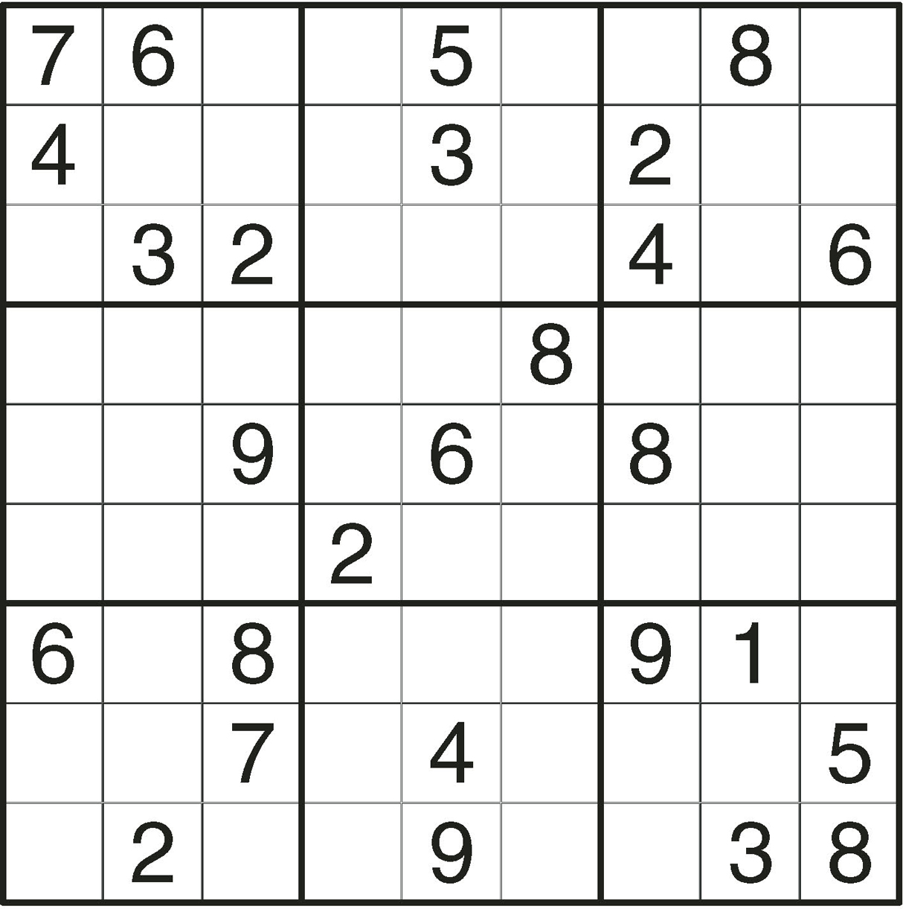
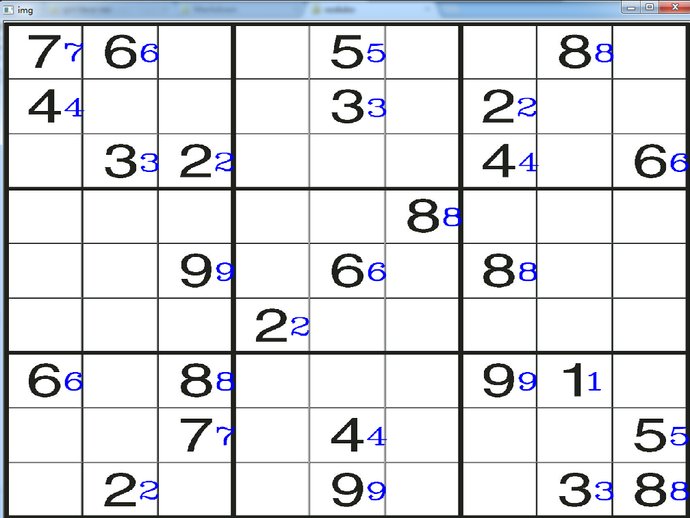
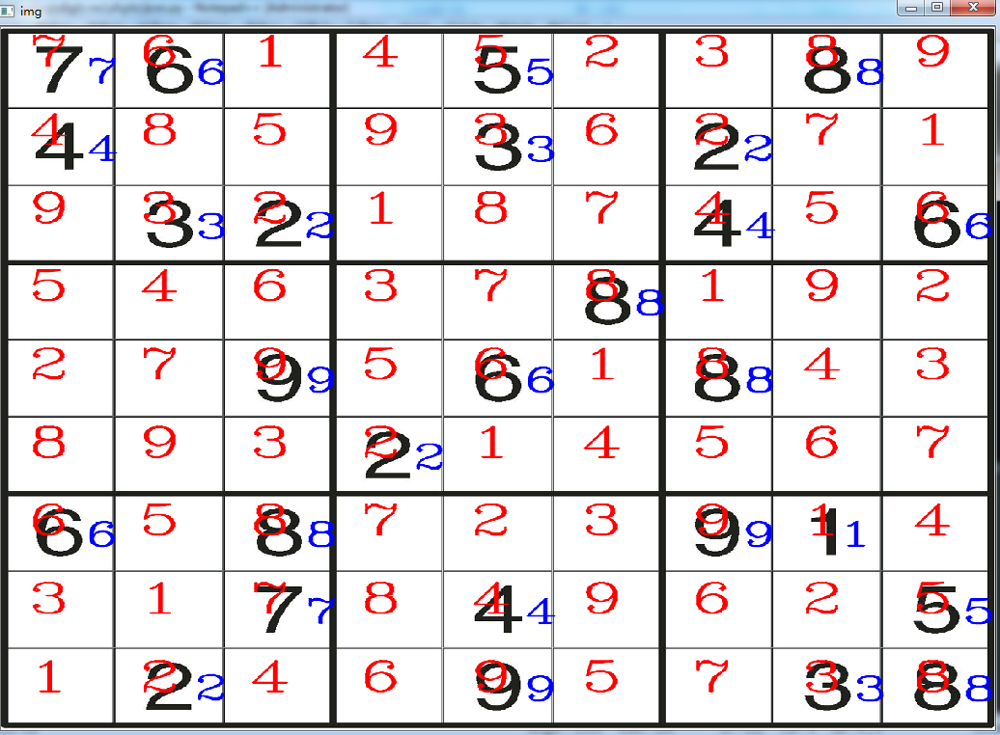

# opencv-sudoku

Solve a Sudoku puzzle from a photo or screenshot using OpenCV and Python.

The program finds the digits in the image, recognises them with a k-Nearest-Neighbours (KNN) classifier, rebuilds the puzzle as a 9×9 grid, solves it with backtracking, and draws the solution back onto the original image.

<div align="center">
  <br/>
  <em>1. Input puzzle</em><br/><br/>
  <br/>
  <em>2. Detected and recognised digits</em><br/><br/>
  <br/>
  <em>3. Solution drawn onto the image</em>
</div>

## How it works

1. **Locate the digits.** The image is converted to grayscale, thresholded and dilated. Contour hierarchy is used to find each grid cell and the digit inside it.
2. **Recognise the digits.** Each digit is cropped, resized to 20×40 pixels, binarised and flattened into an 800-value vector. A KNN model (`cv2.ml.KNearest`) trained on labelled samples classifies it.
3. **Rebuild the grid.** Each recognised digit is placed in a 9×9 NumPy array according to its position. Empty cells are `0`.
4. **Solve.** A recursive backtracking solver fills the grid.
5. **Display.** The solution is printed to the console, checked with row and column sums (each should be 45), and written onto the image.

## Project structure

```
opencv-sudoku/
├── images/            # Puzzle images to solve (e.g. 001.jpg) and README pictures
├── numbers/           # Raw training images: two rows of digits per image
├── number/            # Processed digit images, one sub-folder (0-9) per label
│   └── mkdir.bat      # Creates the 0-9 sub-folders
├── preprocess.py      # Builds the training data (samples.npy, label.npy)
├── knn.py             # Trains KNN, reads the puzzle, solves it, shows the result
├── samples.npy        # Generated: feature vectors (one row per digit)
└── label.npy          # Generated: matching labels
```

## Requirements

- Python 3
- NumPy
- OpenCV **3.x** (e.g. `opencv-python==3.4.18.65`)

```bash
pip install numpy opencv-python==3.4.18.65
```

> **Note:** the code uses the OpenCV 3 form of `cv2.findContours`, which returns three values (`image, contours, hierarchy`). OpenCV 4 returns only two, so on OpenCV 4 change those lines to `contours, hierarchy = cv2.findContours(...)`.

## Usage

### 1. Prepare the training data

Put your training images in `numbers/`. Each image should contain two rows of five digits: the first row is `1 2 3 4 5` and the second row is `6 7 8 9 0`.

Create the output folders (Windows):

```bat
cd number
mkdir.bat
cd ..
```

Then generate the training set:

```bash
python preprocess.py
```

This saves each digit under `number/<label>/` and writes `samples.npy` and `label.npy`.

### 2. Solve a puzzle

Place your puzzle image at `images/001.jpg` (or edit the path in `knn.py`), then run:

```bash
python knn.py
```

A window shows the recognised digits, and the console prints the generated grid, the solved grid and the row/column sums. Press any key to close the window.

## Tips for good results

- Crop the image so the Sudoku grid fills the whole picture, since the cell size is calculated from the image dimensions.
- Use clear, high-contrast images with dark digits on a light background.
- Train on digits in the same font or style as the puzzles you want to solve.
- If digits are misread, add more training images.

## Known limitations

- The `preprocess.py` script uses Windows-style paths (`numbers\\*`, `number\\...`). On Linux or macOS, replace them with `os.path.join` or forward slashes.
- Only printed digits are supported, not handwriting.
- The KNN uses the first 80 samples for training (`k = 80` in `knn.py` is the training-set size, not the number of neighbours; the classifier uses the single nearest neighbour).

## Contributing

Issues and pull requests are welcome.

## License

Add your preferred license here (for example MIT).
